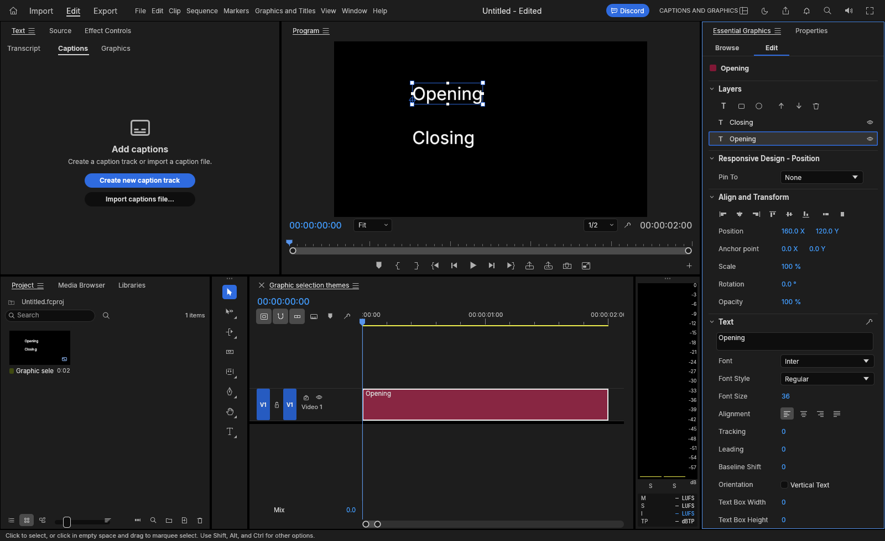
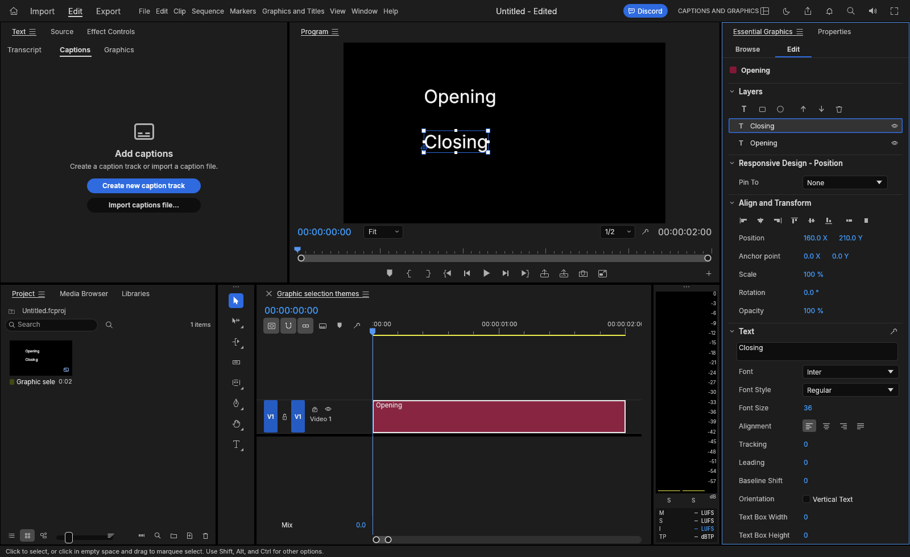
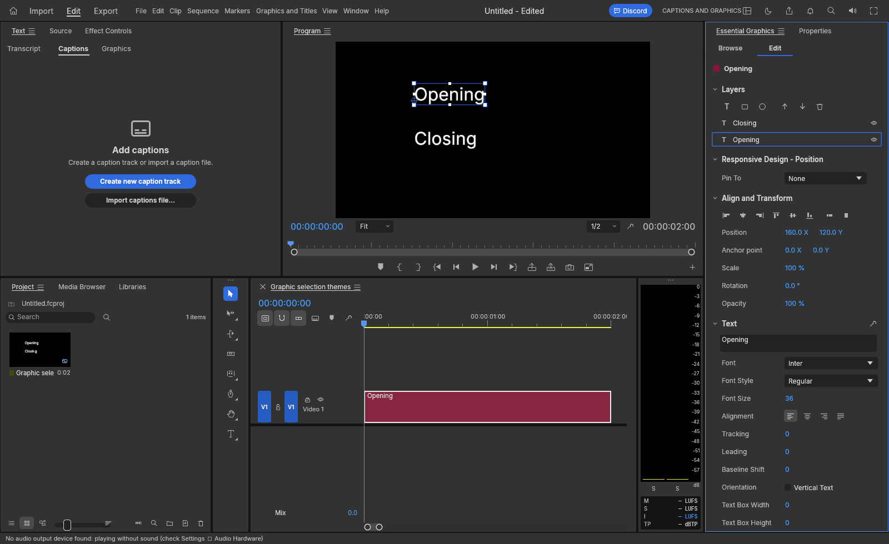
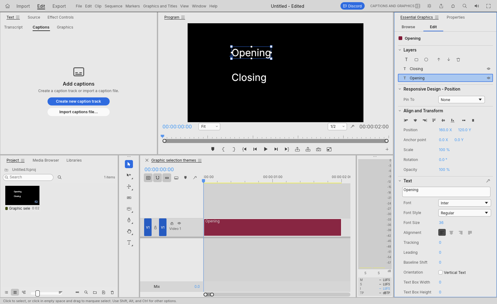
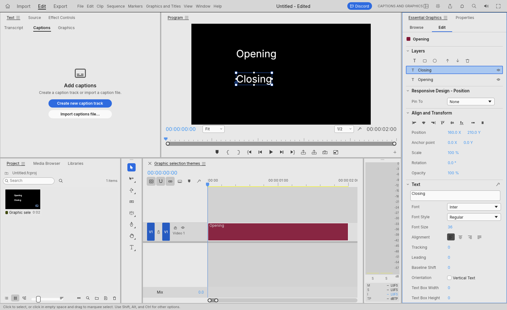

# Historical Graphics selection evidence for FilmCraft PR #1905

These six unmodified original screenshots show the generated **Opening / Closing** graphic-text fixture in FilmCraft's Dark, Medium and Light themes at **1600 x 980**. Each original PNG is 6,273,523 bytes.

This is an isolated evidence-only branch. It contains no product source, project files, executables, private logs, font files or external media.

## Images

| Theme | Layer 0: Opening selected | Layer 1: Closing selected |
|---|---|---|
| Dark | [Original PNG](images/dark-layer-0.png) | [Original PNG](images/dark-layer-1.png) |
| Medium | [Original PNG](images/medium-layer-0.png) | [Original PNG](images/medium-layer-1.png) |
| Light | [Original PNG](images/light-layer-0.png) | [Original PNG](images/light-layer-1.png) |

### dark-layer-0.png

### dark-layer-1.png

### medium-layer-0.png

### medium-layer-1.png

### light-layer-0.png

### light-layer-1.png

## Historical scope and limits

- Source-manifest SHA-256: `e8ad7f5b8af93109f043130f4d6696e89be7e9973325ea367176298caf76605e`. This is a source fingerprint, not a Git commit ID.
- Executable SHA-256: `1875f7943c0d1e4c6c4f8070d724012babf039e0dd8607c70fa939d06faade56`.
- Dark and Medium are four completed captures from original phase **p**, which later aborted. Light is a separately completed two-case continuation **q**. This is **not an uninterrupted six-case pass**.
- The original images were visually reviewed. Selection highlights correspond to canvas handles and the matching Text property. Medium's selection fill is subtle; the outline is the clearer cue. The audio-device notice in `medium-layer-0.png` is retained as part of the historical capture.
- These static images do not qualify keyboard or screen-reader behavior, accessibility standards, reduced viewports, general responsive layout, custom themes, other operating systems or performance.
- These images do not validate current main or a later executable. Complete equivalence between the historical source snapshot and the published PR tree is not established by this package.
- Existing source, dependency, overlap, conflict and review holds remain open. Providing the images does not resolve them.

## Original-byte manifest

| Original PNG | Bytes | SHA-256 |
|---|---:|---|
| `images/dark-layer-0.png` | 6273523 | `6378b1092c951965c6727ad15299f7fdad000eca0e91b507f90bdd8277a689df` |
| `images/dark-layer-1.png` | 6273523 | `0b4bb4e39ffc39b723b37ccf6454921ebead1c7f1371f21090b0c23739ca6371` |
| `images/medium-layer-0.png` | 6273523 | `96490684d6ae9c3680dcd319ca74e6e18c2e2a4acabde8e151f38c1737157458` |
| `images/medium-layer-1.png` | 6273523 | `add6e1bdb04bbf1d4e3a38a4068bccdbc72da05fb9c3c95254da23dcc319cd8f` |
| `images/light-layer-0.png` | 6273523 | `51043d7bc883c85b0b20db9b6b157d837a923e2d405dc152eb4e980e719c0ca4` |
| `images/light-layer-1.png` | 6273523 | `ac32fa0c127f7ffebd43f6769d70bfec76e1cbb4ea1d8b218aa34da8a18d0d67` |

## Attribution and licenses

The screenshots and generated fixture are original contributor work showing FilmCraft. Each PNG has an adjacent `.attribution` file and an entry in [ATTRIBUTION.md](ATTRIBUTION.md). They are offered under [MIT](LICENSE-MIT) OR [Apache-2.0](LICENSE-APACHE).

The unchanged [FilmCraft NOTICE](NOTICE) records the source application's acknowledgments. This evidence package ships screenshots and attribution/license text only; it does not redistribute the application's font binaries or other media.
